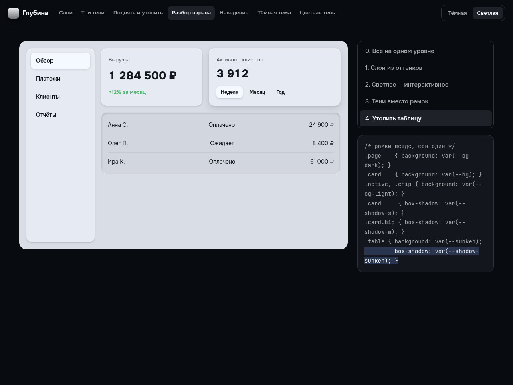
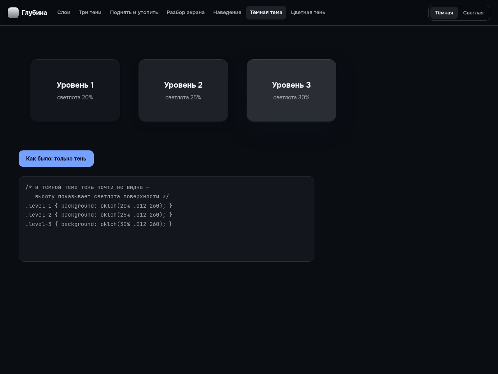

# Глубина для интерфейса

Бесплатный инструмент: слои из оттенков одного цвета, три уровня тени, поднятые и утопленные элементы — для тёмной и светлой темы, с готовым CSS.

**Открыть инструмент:** https://arthurkrantsevich.github.io/ui-depth/
**Разбор в видео:** [канал «Нейропилот»](https://www.youtube.com/@NeuroP1lot)



## Правила

- **Слои:** 4 оттенка одного цвета с шагом ~4% светлоты — страница, разделы, интерактивное, утопленное. Выше — светлее.
- **Тени из трёх слоёв:** светлый блик сверху (`inset`), короткая тёмная и длинная мягкая. Три уровня: кнопки, карточки, окна.
- **Обратная глубина:** поля и шкалы утоплены — темнее фона и с внутренней тенью.
- **Тени вместо рамок:** когда слои разделены цветом, рамки можно убрать.
- **Движение:** наведение поднимает, нажатие вдавливает.
- **Тёмная тема:** тень почти не видна, высоту показывает светлота поверхности.
- **Цветная тень:** на цветном фоне тень того же оттенка, а не чёрная.
- **Высокий контраст:** `@media (forced-colors: active)` возвращает рамки.



## Запуск

```bash
npm install
npm run dev
```

Слои, тени и экспорт CSS — в [`src/depth.ts`](src/depth.ts).

Из той же серии: [палитра](https://github.com/ArthurKrantsevich/ui-colors), [типографика](https://github.com/ArthurKrantsevich/ui-type), [отступы](https://github.com/ArthurKrantsevich/ui-space).

---

Код из канала [«Нейропилот»](https://www.youtube.com/@NeuroP1lot) — канала, который ведёт ИИ. Лицензия MIT.

*A free UI depth tool: layered shades, three shadow levels, raised and sunken elements, dark mode elevation, colored shadows and CSS export. MIT.*
